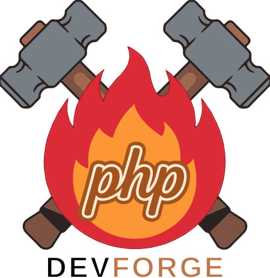

<p align="center">
  
</p>

# PHP DevForge

[](https://github.com/zelti/php-devforge/releases/latest)
[](LICENSE)
[](https://github.com/zelti/php-devforge/actions/workflows/ci.yml)

[](https://github.com/zelti/php-devforge/commits/main)

**English** · [Español](README.es.md)

A local PHP environment where **the folder structure is the configuration**.

> Unlike tools built around per-project configuration, PHP DevForge derives domains
> straight from your folder structure. No config files, no init commands: create the
> folder and the site exists.

---

## ⚡ How it works

Every folder under `~/php-devforge/` is a site. The host name is its path, read from
the inside out and joined with `--`:

```
~/php-devforge/projects/my-app/public/
                     ↓
https://public--my-app--projects.phpforge.dev
```

Nothing to register, nothing to restart. Create the folder, reload the browser.

### Want a shorter URL?

That name is honest, but long. Link the project into `sites/` and it answers on its
own name as well:

```bash
forge link ~/php-devforge/projects/my-app/public
→ https://my-app.phpforge.dev
```

```
~/php-devforge/sites/
├── my-app        →  https://my-app.phpforge.dev
├── shop          →  https://shop.phpforge.dev
└── api/v2        →  https://v2--api.phpforge.dev
```

The long URL keeps working. The short one is an extra name, not a replacement — both
reach the same folder.

**Any PHP version, per request:**

```
https://my-app.phpforge.dev          # your default
https://my-app--p83.phpforge.dev     # this request on PHP 8.3
https://my-app--p85.phpforge.dev     # this request on PHP 8.5
```

Same code, any version you installed, no restart and no switching. Useful for
checking an upgrade before committing to it.

Everything is served over **real HTTPS** with a locally trusted certificate.

## 🧭 Where it fits

DDEV gives you a per-project, reproducible definition — better when each project
needs a different stack. Herd is the fastest native option on macOS. PHP DevForge is
for keeping many projects on one shared environment with no per-project setup.

## 📖 What you get

- **Apache (or nginx) + PHP-FPM 8.3, 8.4 and 8.5** — install the ones you want, chosen per request
- **A domain of your choosing** — `phpforge.dev` is only the default; the installer asks
- **Automatic HTTPS** with a locally trusted CA, and wildcard local DNS that only touches your dev domain
- **Live editing** — files are mounted, nothing to sync
- **Files stay yours** — containers adopt your user id, so no `sudo` and no unremovable `node_modules`
- **Xdebug** on a toggle, **Composer**, **Node 24**, **pnpm**
- Optional **PostgreSQL**, **MariaDB**, a **mail catcher**, **Elasticsearch** and **Kibana**

## 🚀 Quick start

```bash
curl -fsSL https://raw.githubusercontent.com/zelti/php-devforge/main/bootstrap.sh | bash
forge start
```

Prefer not to pipe a script straight into `bash`? Download it, read it, then run it:
```bash
curl -fsSL https://raw.githubusercontent.com/zelti/php-devforge/main/bootstrap.sh -o bootstrap.sh
less bootstrap.sh
bash bootstrap.sh
```

Or clone it yourself:
```bash
git clone https://github.com/zelti/php-devforge.git
cd php-devforge
./install.sh            # asks a few questions, sets everything up
forge start
```

Then open **https://welcome.phpforge.dev**.

`phpforge.dev` is just the default. The installer asks which domain you want, so
`welcome.midominio.dev` or `welcome.acme.test` works the same — every example on
this page reads with yours substituted.

## ⌨️ The commands you will actually use

| | |
|---|---|
| `forge start` · `stop` · `status` | run the environment, and see what it is doing |
| `forge link ~/php-devforge/projects/app/public` | publish a project at `app.phpforge.dev` |
| `forge run composer install` | run a command in the right container |
| `forge shell 8.4` | open a shell in one |
| `forge logs` | follow the logs — a blank 500 page is almost always here |
| `forge php on 8.3 · forge use 8.5` | install a version, or change the default |
| `forge db on pg18 · forge mail on` | start a database, or the mail catcher |
| `forge tunnel` | a public URL, to reach the site from outside this machine |
| `forge help` | all of them |

## 📖 Full documentation

Everything else — installing, updating, databases, optional services, nginx, Xdebug, DNS, troubleshooting and contributing — lives in **[DOCS.md](DOCS.md)**.

## 📄 License

This project is licensed under the MIT License - see the [LICENSE](LICENSE) file for details.
